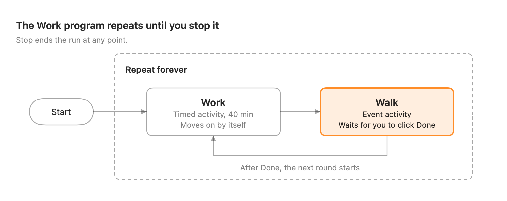

# Orga User Manual

Orga runs routines of activities on your Mac and tells you when to switch: for example, work for 40 minutes, walk 100 steps, and repeat until you stop. It keeps a log of everything you did, so you can see where your time went.

## Getting started

Orga needs macOS 15 or later and runs on Apple silicon and Intel Macs.

1. Put **Orga** in your Applications folder and open it.
    - If macOS says it can't check the app for malicious software, open **System Settings → Privacy & Security** and click **Open Anyway**. You only need to do this once per version.
2. When Orga asks to send notifications, click **Allow**. Orga still works without them, but you could miss an alert while its window is hidden.
3. Try the **Quick demo** program to see everything in a few minutes (see [Running a program](#running-a-program)).

Orga shows up in three places:

- **The main window**, where you run, edit and review programs.
- **The menu bar**, as a small timer icon at the top right of the screen. While a program runs, it shows the current activity and the time left.
- **The Dock**, like any other app.

Closing the window does not quit Orga or stop a running program: the menu bar icon stays. To quit, choose **Quit Orga** from the menu bar icon, or press ⌘Q.

On first launch Orga adds two sample programs. **Work** alternates 40 minutes of work with a 100-step walk, until you stop it. **Quick demo** runs three rounds of a 1-minute focus and a stretch, so you can try every button quickly.

This manual is also in the app: choose **Help → Orga Help** (⌘?), or **User Manual** from the menu bar icon.

## Programs and blocks

A **program** is a routine you build from blocks and save under a name. Orga runs one program at a time, from its first block to its last, unless a loop repeats it or you stop it.

| Block | What it does | Example |
| --- | --- | --- |
| Timed activity | Counts down, then moves on by itself. | Work, 40 min |
| Event activity | Waits until you click **Done**. Use it for things Orga can't measure. | Walk 100 steps |
| Loop | Repeats the blocks inside it: forever, a number of times, or until a time of day. | Repeat forever |
| Program | Runs another saved program in its place. | Your "Stretch" routine |

A loop set to **until a time of day** only checks the time before starting a new round, so a round in progress always finishes. The time means the next time the clock shows it: "until 01:00" started at 22:00 means tonight.

Each activity also has its own alert settings, snooze length and, for event activities, optional reminders. See [Creating and editing programs](#creating-and-editing-programs).

Work counts down on its own; Walk, highlighted, is the step that needs you. Clicking Done starts the next round.

## Running a program

To start a program, do one of these:

- In the window, select **Now** and click **Start** next to the program.
- Open the program in the window and click **Start** (▶) in the toolbar.
- Click the menu bar icon and choose **Start "program name"**.

Start is unavailable while another program is running: stop that one first. It is also unavailable when the program has a problem (see [Problems](#problems)).

While a program runs, **Now** shows the program and round, the activity in large type with its instruction, a countdown with a progress bar, what comes next, and the controls. When an activity is waiting for you to click Done, the view turns orange and says **Your turn**, and the menu bar icon becomes an orange hand.

### The menu bar

| Menu bar shows | Meaning |
| --- | --- |
| Work 32:14 | A timed activity is running, with the time left |
| Walk ● | An event activity is waiting for you to click Done |
| Walk in 4:59 | The activity is snoozed and comes back in 4:59 |
| Work ⏸ 32:14 | The program is paused |
| Timer icon only | Nothing is running |

Click the icon for a menu with the current and next activity, the controls, your programs, Settings and Quit.

### Controls

The same controls are in the window, the menu bar menu and, for Done, Snooze and Skip, the notification buttons.

| Control | What it does |
| --- | --- |
| Done | Completes an event activity and moves to the next block. In the window, Return also works. |
| Snooze | "Not yet." Puts the activity off for its snooze length. A timed activity's countdown is held and continues afterwards; an event activity alerts you again. Snoozing again restarts the snooze. |
| Skip | Ends the activity without completing it and moves on. |
| Pause / Resume | Freezes all timers. Paused time doesn't count towards the activity. |
| Stop | Ends the run. |

### When you're away from the Mac

While a program runs, Orga stops your Mac from going to sleep on its own, so timers and alerts keep working while you walk or exercise. The screen can still turn off or lock, and locking doesn't pause the run.

If the Mac sleeps anyway, for example when you close the lid, Orga catches up when it wakes. Activities that ended meanwhile are logged at the time they really ended, and you get one alert for the activity that's current now.

### Quitting during a run

If Orga quits while a program is running, it remembers the run. Next time it opens, **Now** offers **Resume**, which catches up as after sleep, or **Discard**, which ends the run.

Editing a program while it runs doesn't change the current run. Your changes apply the next time you start it.

## Alerts

Orga alerts you when an activity starts, when a snooze ends and, if you set it, with reminders while an event activity is waiting. Each activity chooses how:

- **Notification** (the default): a banner with **Done** (event activities only), **Snooze** and **Skip** buttons, plus the activity's sound. Orga keeps only the latest alert on screen, so an old banner can't act on the wrong activity.
- **Full-screen overlay**: everything a notification does, plus a screen that covers every display, even full-screen apps. Use it for activities you must not miss.

On the overlay, the main button is **Done** for event activities and **OK** for timed ones; Return presses it. **Snooze** and **Skip** work as anywhere else. Press Escape or click **Dismiss** to close the overlay without acting: the program keeps running. The overlay also closes by itself if you deal with the activity from the menu bar or the window.

To set an activity's alert, sound or reminders, select it in the program and use the inspector (see [Creating and editing programs](#creating-and-editing-programs)). When a program finishes, Orga plays the default sound from Settings and posts a "finished" notification.

## Creating and editing programs

Your programs are listed in the sidebar under **Programs**. Click one to open it. Changes are saved as you make them; there is no Save button.

- **New program:** click **+** at the top of the sidebar. Orga creates an empty "New Program" and opens it.
- **Rename:** click an empty spot in the outline so no block is selected, then edit **Name** in the inspector.
- **Duplicate or delete:** Control-click (or right-click) the program in the sidebar. Delete asks first and can't be undone.

### The outline

A program's blocks appear as an indented outline; blocks inside a loop are indented under it.

- **Add:** click **Add Block** (+) in the toolbar and choose Timed Activity, Event Activity, Loop or Program. The new block goes inside the selected loop, after the selected block, or at the end when nothing is selected.
- **Move:** drag a block to a new place, into a loop or out of it. Dropping a block onto an activity puts it right after that activity.
- **Delete:** select the block and press Delete, or click the trash button.
- **Undo:** ⌘Z undoes adding, deleting and moving blocks; ⇧⌘Z redoes.

### The inspector

The panel on the right shows the settings of whatever is selected. Hide or show it with the panel button at the right end of the toolbar.

| Selected | You can set |
| --- | --- |
| Nothing | The program's name, notes and default snooze |
| Timed activity | Name, instruction, duration in minutes and seconds, alert, sound, custom snooze |
| Event activity | Name, instruction, alert, sound, custom snooze, a reminder every few minutes while it waits |
| Loop | Repeat forever, a number of times, or until a time of day |
| Program | Which program to use; **Open** it; **Convert to Copy** |

The speaker button next to **Sound** plays it. With **Custom snooze** off, an activity uses its program's default snooze.

### Problems

A program with a problem can't start until you fix it. Orga shows a red triangle on the block, a "Can't start yet" banner above the outline and a red triangle next to the program in the sidebar. Select the block to read what's wrong in the inspector.

The usual causes are an empty loop, an activity without a name, a duration of zero, or a used program that is missing or has problems of its own.

## Using a program inside another

Any saved program can be a block in another one. Build a "Stretch" routine once, then use it in Work, Study and Evening, and improve it in one place: every program that uses it picks up the change.

1. Open the program you want to add it to and select where it should go.
2. Click **Add Block** (+) → **Program** and choose the program.
3. The block shows the program's name and how long one pass takes ("open-ended" if it repeats forever or until a time). Click its disclosure arrow to preview its blocks; the preview is greyed out because you edit them in the program itself.
4. To edit the used program, select the block and click **Open** in the inspector.

**Convert to Copy** in the inspector replaces the block with a copy of the program's blocks. From then on they belong to this program, and changes to the original no longer apply here.

The rules:

- A program can't include itself, directly or through other programs. Orga only offers programs that are safe to add.
- If a used program is deleted, or has a problem, the programs that use it can't start until you fix or remove it. Deleting a program warns you which programs use it.
- Each used program keeps its own default snooze.
- Orga copies the used programs when a run starts, so editing one mid-run doesn't affect the run.
- In the log and Analytics, its activities count under the program you started.

## Log and Analytics

Orga records every run as it happens: each activity's start and end, how it ended, and any snoozes and pauses. An activity appears once it ends, so the one in progress isn't counted yet.

### Log

Select **History → Log** in the sidebar. Runs are listed newest first, each with its time span, length, rounds and how it ended: Finished, Stopped, Interrupted (Orga quit) or Running. Under each run, every activity shows:

- a green check (completed), a skip arrow (skipped) or a stop sign (stopped by you);
- its start time, name, round and actual time spent;
- a "zzz" icon with the number of snoozes, a pause icon with paused time, and a moon if it ended while the Mac was asleep.

Use the toolbar to filter by program and period. **Export CSV** saves the runs shown as a spreadsheet file, one row per activity.

### Analytics

Select **History → Analytics**. Choose a period (Today, Last 7 Days, Last 30 Days, All Time) and a program in the toolbar.

- **All Programs** shows totals, time per program, a by-day chart stacked by program, and a table for each program's activities.
- **One program** shows its totals, time per activity, a by-day chart stacked by activity, and its activity table.

Activities are always counted within their program: "Work" in two programs is reported separately. Hover over a day in the by-day chart to see its breakdown. Each program and activity keeps the same color whatever period you choose.

## Settings

Open Settings with ⌘, while Orga's window is in front, or choose **Settings…** from the menu bar icon.

| Setting | What it does |
| --- | --- |
| Open Orga at login | Starts Orga when you log in. If macOS asks you to approve it, click **Open Login Items…** and allow Orga there. |
| Default snooze | Snooze length for new programs. Existing programs keep theirs. |
| Sound | Sound for new activities, and the sound played when a program finishes. |
| Notifications | Shows whether Orga may send notifications. **Open Notification Settings…** goes to Orga's page in System Settings; **Send Test Notification** checks that alerts arrive. |

## Troubleshooting

| If… | Try this |
| --- | --- |
| Notifications don't appear | Open Settings. If Notifications says "Turned off for Orga", click **Open Notification Settings…** and allow them. Also check that a Focus mode isn't silencing Orga. |
| No full-screen overlay appears | The overlay only appears for activities whose **Alert** is set to **Full-screen overlay** in the inspector. |
| Start is greyed out | Another program is running (stop it first), an interrupted run is waiting for Resume or Discard on **Now**, or the program has a problem (look for the red triangle). |
| A block says "… has problems. Fix it first." | The program it uses has a problem. Select the block, click **Open**, and fix it there. |
| A block says the program "no longer exists" | The program it used was deleted. Delete the block or choose another program in the inspector. |
| **Now** says a program was interrupted | Orga quit during a run. Click **Resume** to continue or **Discard** to end it. |
| The timer jumped after the Mac woke up | Orga caught up on the time the Mac was asleep. Activities that ended meanwhile show a moon in the log. |
| The menu bar icon is missing | The menu bar may be full; on Macs with a notch, extra icons are hidden. Quit some menu bar apps to make room. |

### Where your data is kept

Everything stays on your Mac, in your user folder:

| What | Where |
| --- | --- |
| Programs, one file each | ~/Library/Application Support/Orga/Programs/ |
| Log | ~/Library/Application Support/Orga/Log.store |
| A run in progress | ~/Library/Application Support/Orga/current-run.json |

To open the folder, choose **Go → Go to Folder…** in the Finder and paste the path. To back up your programs or move them to another Mac, copy the Programs folder, then reopen Orga. If a program uses other programs, copy those too.
